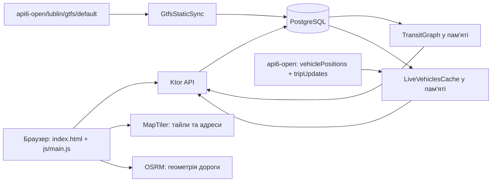

# Поточна архітектура transit-alert

Основний опис звірено з кодом 01.11.2026; перехід GTFS на api6-open,
формат зупинок і пов'язані перевірки оновлено 04.11.2026.
Документ описує наявну реалізацію, включно
з її обмеженнями. Плану рефакторингу тут немає. Інструкції запуску — у
[README.md](../README.md).

Первинна перевірка була статичною. Під час переходу GTFS додатково виконано
переімпорт, перевірки узгодженості БД, GET-запити до API та тести.
Це не підтверджує візуальну працездатність у браузері або на мобільних пристроях.

## 1. Загальна будова та потоки даних

Є два окремі процеси: HTTP-сервер статичних файлів фронтенду та Kotlin/Ktor
API на порту 8080. Бекенд використовує PostgreSQL. Фронтенд не збирається:
браузер завантажує `index.html`, сім статичних CSS-файлів та ES-модуль
`frontend/js/main.js`.

Основні файли:

| Місце | Відповідальність |
|---|---|
| `frontend/index.html` | Розмітка екранів, ранній вибір теми, підключення CSS, MapLibre, `config.js` і точки входу |
| `frontend/js/main.js` | ES-модуль-точка входу: читає конфігурацію, створює модулі та з'єднує їхні залежності |
| `frontend/js/{city-map,trip-map,planner,stops,reports,navigation}.js` | Модулі головної карти, мінікарти рейсу, планувальника, табло зупинок, звітів і навігації; стан кожного екрана локальний для його фабрики |
| `frontend/js/{config,location,nearby,theme,ui,marker-animation}.js` | Спільні сервіси конфігурації, геолокації, nearby-кешу, теми, UI та анімації маркерів |
| `frontend/css/*.css` | Розділені стилі базових правил, спільних компонентів, карти, планувальника, зупинок, звітів і сумісності |
| `frontend/config.example.js` | Шаблон `window.MAPTILER_KEY`; локальний `config.js` виключений із Git |
| `frontend/style-light.json`, `style-dark.json` | Стилі MapLibre на основі OSM Liberty |
| `frontend/manifest.json` | Назва, стартова сторінка, standalone-відображення, кольори; service worker відсутній |
| `backend/src/main/kotlin/com/artem/transitalert/` | Увесь прикладний Kotlin-код в одному пакеті |
| `backend/src/test/kotlin/com/artem/transitalert/` | Тести часу GTFS, пошуку альтернатив, формату зупинок/NŻ і порядку платформ |
| `tools/warm_style.py` | Окрема утиліта зміни кольорів JSON-стилів, не частина запуску застосунку |

Стилі карти посилаються не лише на MapTiler: там також є raster-тайли
`klokantech.github.io`, sprite `maputnik.github.io` та glyphs `orangemug.github.io`.
MapLibre JS і CSS завантажуються з cdnjs, версія 4.7.1.

## 2. Фронтенд: HTML, стан і залежності

### 2.1. Екрани та модулі

У [frontend/index.html](../frontend/index.html) карта `#map` є постійною основою. Над нею показуються
`#screen-route` (Trasa), `#screen-stop` (Przystanek), панель звітів
`#reports-drawer`, форма `#report-modal`, швидка форма `#quick-report-modal`
та окрема карта `#vehicle-modal` із контейнером `#modal-map`.
Нижнє меню — `#bottom-nav`. Спільне затемнення — `#overlay`.

[frontend/js/main.js](../frontend/js/main.js) підключений із `type="module"`
наприкінці HTML. Він імпортує усі фронтенд-модулі, але сам не містить логіки
екранів. `createCityMap`, `createTripMap`, `createPlanner`, `createStops`,
`createReports` і `createNavigation` повертають обмежений публічний інтерфейс.
`main.js` передає їм потрібні функції й сервіси як залежності, зокрема
навігаційні callback-и для планувальника та табло.

Фронтенд не має центрального store або окремого шару API: кожен модуль виконує
свої `fetch`-запити й володіє власним станом. Обробники подій реєструються в
`init…()` модулів через `addEventListener`; inline-обробників у поточній
розмітці немає.

### 2.2. Власники стану

| Модуль | Основний локальний стан |
|---|---|
| `config.js` | Обчислена адреса API; ключ MapTiler читається з класичного `config.js` через глобальний `MAPTILER_KEY` |
| `city-map.js` | Головна MapLibre-карта, LIVE-маркери й кластери, 2D/3D, GPS-маркер, коло точності та інтервал LIVE |
| `trip-map.js` | Карта рейсу, її маркери, `AbortController`, інтервал опитування та стан ручної взаємодії з картою |
| `marker-animation.js` | Набір маркерів в анімації та спільний цикл `requestAnimationFrame` |
| `location.js` | Єдиний `watchPosition`, остання позиція й помилка геолокації |
| `planner.js` | Вибрані точки, історія маршрутів, таймер LIVE-часу, відкриті картки й стан свайпу |
| `stops.js` | Вибрана платформа, відправлення, часові зсуви, інтервал оновлення та стан свайпу |
| `reports.js` | Індекс звітів, кеш ліній, вибір форми, контекст оновлення й fingerprint |
| `navigation.js` | Ініціалізація History API та стану drawer/overlay через DOM |
| `nearby.js`, `ui.js`, `theme.js` | Спільний двохвилинний nearby-кеш, timeout toast і налаштування теми відповідно |

Частина стану міститься в самому DOM: класи `open`, `show`, `active`,
`fullscreen-expanded`, `style.display`, `data-trip-id`, `data-min`,
`data-delay`, `data-delay-initial`, `data-live`, `data-dep-key`.
Наприклад, `updateTrasaCountdowns` читає часові дані з рядків картки,
а `loadDepartures` перед перебудовою списку запам'ятовує відкриту панель і скрол.

Постійна пам'ять браузера — `localStorage`:

| Ключ | Вміст |
|---|---|
| `themePref` | `auto`, `day` або `night` |
| `ta_fingerprint` | Локальний ідентифікатор для звітів і голосів, генерується через `Math.random` та `Date.now` |
| `ta_recent_route_stops` | До 4 останніх точок планувальника; дублікати визначаються назвою |
| `ta_recent_routes` | До 10 пар початок/кінець; ключ дубліката складається з назв |
| `ta_recent_stops` | До 2 платформ у вкладці Przystanek; дублікати за `stopId` |
| `ta_gtfs_id_format` | `zbiorkom-api6`; маркер одноразового очищення історій зі старими GTFS ID |

Перед ініціалізацією екранів `main.js` викликає `resetLegacyTransportHistory`
із `transport-history.js`. Без актуального маркера видаляються лише три
`ta_recent_*` ключі з таблиці й записується маркер; тема та fingerprint зберігаються.
При наступних стартах нова історія вже не очищається.

Це локальна історія конкретного браузера, не обліковий запис і не синхронізація
між пристроями. History API окремо зберігає стан навігації `screen` та `overlay`.

### 2.3. Порядок ініціалізації

1. У `<head>` HTML виконується коротка функція з `localStorage.getItem('themePref')`:
   до показу сторінки встановлює `document.documentElement.dataset.theme`.
2. Після розмітки послідовно підключаються MapLibre, класичний `config.js` і
   `js/main.js` із `type="module"`.
3. `startApp` у `main.js` за потреби чекає `DOMContentLoaded`, перевіряє
   MapLibre, ініціалізує анімацію та читає `apiBaseUrl` через `readConfig`.
4. Точка входу створює фабрики карти, мінікарти й навігації, налаштовує тему,
   після чого створює та ініціалізує звіти, планувальник, табло і навігацію.
5. Далі викликаються `cityMap.initCityMap()`, `planner.renderRecentRoutes()` і
   `navigation.initializeHistory()`.
6. Після `map.load` модуль головної карти запускає GPS, перше завантаження
   LIVE-транспорту та інтервал 5000 мс.

Табло та пошук поїздок завантажуються за діями користувача. Початковий колір
HTML і далі задає короткий скрипт у `<head>`; `theme.js` не викликає
`applyTheme` на старті, а головна карта читає актуальну тему під час створення.

### 2.4. Події та навігація

Події статичної розмітки підключаються через `addEventListener` в
`navigation.js`, `planner.js`, `stops.js` та `reports.js`. Динамічно створені
картки отримують слухачі безпосередньо після вставлення в DOM; це замінило
колишні inline-виклики.

`switchScreen(screenId, btn, isBackAction)` перемикає видимість екранів,
активну кнопку меню, закриває мінікарту й панель звітів за потреби.
Для звітів він викликає `openDrawer('Zgłoszenia', renderReportsList)`;
для зупинок — `loadNearbyStopsDefault`, якщо ще немає вибраної платформи;
для Trasa — оновлює кнопки полів та історію поїздок.
Новий перехід додається через `history.pushState`, повернення назад — без нього.

Розкриття карток використовує стани `overlay: 'accordion'` для Trasa
і `overlay: 'depAccordion'` для табло. Мінікарта додає `screen: 'vehicleMap'`.
Кнопки закриття карток і мінікарти використовують `history.back()`.
Обробник `popstate` закриває мінікарту, прибирає невідповідні акордеони
і відновлює одну з чотирьох вкладок. Повторне відкриття мінікарти при переході
вперед за станом `vehicleMap` не реалізоване.

Форми звітів керуються класами та спільним overlay, без власного запису
в History API. Натискання overlay викликає `closeDrawer`, `closeModal`,
`closeQuickModal`. Поля форм мають `input`, `blur` та `focus`-обробники;
списки підказок закриваються також через обробники кліку по `document`.

## 3. Карта, GPS і LIVE

### 3.1. Головна карта

`initMap` у `frontend/js/city-map.js` створює `maplibregl.Map` у `#map`: центр `[22.5684, 51.2465]`,
zoom 14, локальний JSON-стиль за темою. `transformRequest` підставляє
`MAPTILER_KEY` замість `{key}` у MapTiler URL. Координати MapLibre мають
порядок `[lon, lat]`; відповіді API зазвичай містять окремі `lat` і `lon`.

Контроли: масштаб, `GeolocateControl`, власна кнопка теми та 2D/3D.
`setMapMode3D` змінює нахил і викликає `apply3D`, який знаходить джерело
будівель у поточному стилі й додає `3d-buildings`.
`style.load` відновлює 3D та коло точності GPS після зміни стилю.
`rotate` повертає стрілки транспорту, `zoomend` і `pitchend` перераховують кластери.

### 3.2. GPS

`trackUserLocation` у `city-map.js` делегує стеження модулю `location.js`.
Той запускає `navigator.geolocation.watchPosition` із `enableHighAccuracy`,
`maximumAge: 5000`, `timeout: 10000`. Попередній watch за наявності очищається.
Перша позиція створює DOM-маркер `.user-marker-dom` і переміщує камеру,
наступні позиції пересувають цей маркер.

`updateUserLocationAccuracyCircle` будує GeoJSON-полігон із 64 вершинами
за точністю GPS. `syncUserLocationAccuracyCircle` додає або оновлює джерело
`user-location-accuracy` і fill/line-шари. Колір читається із CSS `--blue`.

Власний watch та `GeolocateControl` є окремими механізмами. Nearby-пошук
використовує координати маркера, а коли їх немає — одноразовий
`getCurrentPosition`. `applyMyCurrentLocation` створює точку
`{name: 'Moja lokalizacja', isDynamicGps: true}`; координати підставляються
з маркера під час натискання пошуку поїздки.

### 3.3. LIVE-карта та анімація

`updateLiveCityMap` отримує `/live-vehicles`. Для кожного `tripId` створює
або пересуває DOM-маркер у `activeVehicleMarkers`; зниклі з відповіді рейси
видаляє. Обертання стрілки враховує `bearing` автобуса та поворот карти.

`animateMarkerTo` зберігає проміжний стан у `marker._anim` і запускає спільний
цикл `requestAnimationFrame` через `animStep`. Стрибки понад 600 м та оновлення
при `document.hidden` застосовуються одразу. Тривалість руху обмежується
і множиться на `MOVE_SMOOTHING = 0.4`.

`applyVehicleClustering` групує маркери за відстанню до 34 пікселів при zoom
менше 14, ховає окремі DOM-маркери й показує кластер із кількістю машин.
Це власне групування, не кластеризація GeoJSON-джерела MapLibre.
Анімаційний цикл перераховує кластери приблизно раз на 600 мс.

### 3.4. Мінікарта конкретного рейсу

`showVehicleOnMap(tripId, routeContext)` у `trip-map.js` спочатку викликає повне очищення
`closeVehicleMapModal`, створює сесію з `AbortController` і запитує
`fetchVehiclePosition`. Без LIVE-позиції показує повідомлення та не відкриває карту.
Після відкриття чекає 200 мс для розміру контейнера й створює окрему MapLibre-карту.

Таймер 5000 мс оновлює позицію. Сесія перевіряє свою актуальність і має
`inFlight`, щоб не запускати паралельні запити позиції. Маркер користувача
копіюється з головної карти, якщо вже існує. Камера слідує за автобусом
або кадрує обидва маркери; ручна взаємодія вимикає слідування.

`closeVehicleMapModal` скасовує запит позиції, timeout ініціалізації,
інтервал і анімацію маркера, видаляє обидва маркери та карту.
Запити геометрії у `drawRouteShape` не отримують цей AbortSignal,
але перевіряють актуальність карти після асинхронних відповідей.

`drawRouteShape` бере впорядковані координати з `/api/trip-stops/{tripId}`,
передає їх у `router.project-osrm.org/route/v1/driving/...` і малює GeoJSON.
Це відновлення дороги через точки зупинок, не GTFS `shapes.txt`.
Якщо коректна JSON-відповідь OSRM не містить маршрутів, використовується
пряма лінія через зупинки. Мережева помилка потрапляє в `catch` без цього fallback.
Для контексту `mode: 'trasa'` виділяється активний відрізок між координатами
посадки й висадки. Допоміжні функції — `findNearestVertexIndex`,
`sliceLineString`, `projectPointToLineString`.

### 3.5. Періодичні оновлення

| Механізм | Період і умова | Завершення / обмеження |
|---|---|---|
| Головна LIVE-карта | 5000 мс після `map.load` | При переході вкладок не вимикається; немає `inFlight` |
| Мінікарта | 5000 мс після її створення | Повне очищення при закритті, перевірка сесії та `inFlight` |
| Таймери Trasa | 15000 мс після успішного пошуку | Один локальний `trasaCountdownInterval` у `planner.js`; явного очищення немає |
| Табло | 15000 мс після завантаження | Інтервал залишається, але запит робиться лише при видимому `screen-stop` і вибраній зупинці |
| GPS | Події `watchPosition` | Попередній watch очищається при повторному запуску; при зміні вкладки не зупиняється |

Опитування фронтенду частіше за оновлення GTFS-RT на бекенді: новий запит
до API не обов'язково означає нову GPS-позицію.

## 4. Планувальник Trasa

`setupRouteAutocomplete` у `planner.js` одночасно шукає зупинки через `/stops/search`
та адреси через MapTiler Geocoding API, використовуючи `Promise.all`.
Геокодинг обмежений bbox `22.35,51.11,22.75,51.36`, мовою `pl`;
відображаються до 4 адрес. Точки зберігаються як `{name, ids}` для групи
платформ або `{name, lat, lon}` для адреси. GPS-точка має `isDynamicGps`.

Порожні поля показують історію й nearby-результати через
`loadRouteDefaultSuggestions`, `groupStopsByNameAndDistance`,
`createRouteSuggestionElement`. Кнопки полів змінюють дію GPS/очищення/обмін
за `updateRouteButtonState`. `swapRoutePoints` міняє об'єкти й тексти полів
та може одразу запустити пошук.

Натискання `#route-search-btn`:

1. Оновлює динамічні GPS-точки, перевіряє обидві точки, зберігає історію.
2. Формує `from`/`to` зі списків ID або `fromLat`/`fromLon`, `toLat`/`toLon`.
3. Викликає `/route/complex?...&limit=8`.
4. Сортує відповіді за відправленням першого транспортного відрізка.
5. `buildJourneyCard` створює DOM-картки та записує часові дані в `data-*`.
6. Запускає `updateTrasaCountdowns` і його інтервал.

`JourneyResponse` містить `totalMinutes` та `legs`. Відрізок має `route`,
`tripId`, ID й назви посадки/висадки, `departureMin`, `arrivalMin`,
`isRealTime`, `delayMinutes`. Піший відрізок позначається `route: 'Пішки'`.
`buildJourneyCard` не створює картку для суто пішої поїздки.

Поточні хвилини від бекенда вже враховують зсув затримки у графі.
`rowLiveMin` додає лише різницю між поточною та початковою затримками.
`updateTrasaCountdowns` пакетно запитує `/live-vehicles/delays?tripIds=...`,
оновлює час кожного рейсу, статус, тривалість та попередження про пересадку.
Якщо нової LIVE-затримки немає, зберігає останню відому.

`toggleTrasaExpand` розгортає картку; `fetchLegStops` завантажує зупинки
через `/trips/{tripId}/upcoming-stops?fromStopId=...` та обрізає їх
за `toStopId`. Якщо його не знайдено — лишає до 8 зупинок.
`refreshOpenTrasaPassedStops` оновлює позначки `isPassed` відкритої картки.
Кнопка карти передає контекст відрізка в `showVehicleOnMap`.

Рух пальця вгору на нижній межі списку запускає пошук пізніших поїздок:
використовується `time = lastJourneyDepartureMin + 1`.
Порожня відповідь зсуває наступний старт ще на 180 хвилин.

## 5. Зупинки Przystanek

`loadNearbyStopsDefault` у `stops.js` показує останні платформи та запускає nearby-пошук.
`showNearbyStops` використовує спільний двохвилинний кеш або `/stops/nearby`.
Введення від двох символів у `#stop-screen-search` викликає `/stops/search`;
клієнт додатково сортує точні збіги, початки назв, назви та коди платформ.

`createStopSuggestionElement` створює картку з назвою, платформою та лініями.
Клік зберігає `currentStopIdForDepartures`, скидає часові зсуви та викликає
`loadDepartures`. Ця функція отримує `/stops/{stopId}/departures?offset=...`,
веде `currentDeparturesData`, малює статуси розкладу/LIVE, затримки та історію.

Початкове завантаження замінює список. Свайпи додають до 3 попередніх
або наступних записів; при довгому списку обрізають протилежний край.
Фонове оновлення замінює список при нульових зсувах або оновлює наявні записи.
Поточний ключ зіставлення — `route-scheduledTime`, не `tripId`.
Скрол і відкрита панель зберігаються при повторному малюванні.

`toggleDepExpand` та `renderDepExpand` показують наступні зупинки й кнопку
мінікарти. Позначки проїзду надходять як `isPassed` з API.
Рух пальця вниз на верхній межі завантажує історію; рух угору на нижній —
майбутні відправлення. Логіка шукається за коментарем `Ручне оновлення`.

## 6. Звіти та модальні форми

Стрічка відкривається через `switchScreen` у `navigation.js` → `openDrawer` → `renderReportsList` у `reports.js`
→ `fetchReports` → `/reports`. `reportsById` індексує дописи; відсутні оригінали
для цитат оновлень завантажує `fetchReportById`. `reportCardHtml` генерує HTML.
`vote` надсилає fingerprint у `/reports/{id}/confirm` або `/deny`
і оновлює лічильники картки. Коментарі екрануються через `escapeHtml`.

Кнопка `#fab-report` із текстом `Kanar obok!` прив'язана до `openModal`,
тобто відкриває основну форму. Вкладка Linia працює з `route`, `stopName`,
`direction`; Przystanek — з конкретним `stopId`.
`loadRoutesForAutocomplete` отримує `/routes`, `loadDirectionsForRoute` —
`/routes/{route}/directions`. Поля зупинок використовують `/stops/search`.

`submitReport` додає fingerprint, коментар і за потреби `previousReportId`,
надсилає `POST /reports`, обробляє 429 та інші помилки, скидає форму,
закриває її й показує повідомлення. `openUpdateModal` заповнює форму
зі звіту в `reportsById` і встановлює `updateContext`.
Оновлення створює новий допис із посиланням на попередній.

Швидка форма має окремі `openQuickModal`, `selectQuickOption`,
`sendQuickReport`. Її варіанти в HTML задані вручну; відправлення наразі
лише закриває форму та показує toast. Виклику `openQuickModal` зі звичайної
кнопки відкриття форми немає.

## 7. CSS і теми

Стилі завантажуються з `css/base.css`, `shared.css`, `map.css`, `planner.css`,
`stops.css`, `reports.css` і `compatibility.css`. У розмітці та шаблонах модулів
досі є окремі inline-стилі; JavaScript також установлює частину значень через
`.style` та `setProperty(..., 'important')`.

| Частина | Основний CSS | Зв'язок із JavaScript |
|---|---|---|
| Палітра | `base.css`: `:root`, `:root[data-theme="dark"]`, `--blue`, `--bg`, `--card`, `--text` | `theme.js`; коло точності читає `--blue` |
| Карта | `map.css`: `.user-marker-dom`, `.vehicle-arrow`, `.vehicle-marker-dot`, `.vehicle-cluster`, `.maplibregl-ctrl-group` | `city-map.js` і `trip-map.js` |
| Екрани й навігація | `shared.css`: `.screen-container`, `#bottom-nav`, `.nav-item.active` | `navigation.js` і `style.display` |
| Зупинки | `stops.css`: `.stop-suggestion-item`, `.stop-routes-carousel`, `.route-pill`, `.dep-card`, `.dep-expand.open`, `.ghost` | `stops.js` |
| Планувальник | `planner.css`: `.trasa-card`, `.fullscreen-expanded`, `.trasa-row`, `.trasa-middle-scroll` | `planner.js` |
| Звіти й форми | `reports.css`: `.report-card`, `.rc-vote-btn`, `#reports-drawer.open`, `#report-modal.show`, `.form-tab.active` | `reports.js`, `navigation.js` |
| Модальна карта | `map.css`: `.modal-overlay`, `.modal-content`, `#modal-map`, `.close-btn` | `trip-map.js` |
| Повідомлення | `shared.css`: `#toast.show` | `ui.js` створює елемент за потреби |

CSS використовує абсолютне/fixed-позиціонування, вкладені селектори,
`z-index`, safe-area та приховування загального скролу `html, body`.
Основні шари: карта 0, екрани 100, FAB 400, модальна карта 450,
меню 500, overlay 550, drawer 600, форма 700, швидка форма 750, toast 900.
Розгорнута картка Trasa має власний `z-index: 1000`; фактичне накладання
залежить також від контекстів батьків, не лише від цих чисел.

Тема має два рівні: значення `auto/day/night` у сховищі й ефективне
`light/dark` у `data-theme`. `getEffectiveTheme` враховує системну тему
через `matchMedia`. Кнопка циклічно змінює налаштування; в auto зміни ОС
викликають `applyTheme`. `syncMapStyle` змінює JSON-стиль лише за потреби.
Зміна теми також видаляє `modalMap`, якщо він існує, але не викликає повне
очищення модальної сесії.

## 8. Бекенд: компоненти, дані та API

### 8.1. Процес і конфігурація

Це Kotlin/JVM, а не Java-застосунок за мовою вихідного коду:
Kotlin 2.0.20, Ktor 2.3.12, toolchain Java 17, Gradle wrapper 8.9.
Точка входу — `ApplicationKt`, `main` у `Application.kt`.
Один Gradle-проєкт, без окремих підмодулів.

`Application.module` послідовно виконує `DatabaseFactory.init`,
`TransitGraph.buildGraph`, `TransitGraph.startNightlyRebuild`, встановлює
CORS, JSON ContentNegotiation і CallLogging, реєструє шість груп маршрутів,
запускає LIVE і GTFS polling через `GlobalScope`.
Бекенд не роздає frontend-статику. WebSocket/SSE у реалізації немає;
клієнт отримує зміни через повторні HTTP GET.

`DatabaseFactory` створює Hikari pool до 5 з'єднань; параметри читає
з `DB_URL`, `DB_USER`, `DB_PASSWORD`. Дефолти відповідають Compose:
`localhost:5432/transit_alert`, `transit`, `transit`.
HTTP host/port задані в коді: `0.0.0.0:8080`. Автоматичного завантаження `.env`
немає. CORS дозволяє `anyHost()`, GET/POST/OPTIONS та Content-Type.
StatusPages є в Gradle-залежностях, але плагін не встановлений у `Application.module`.
Logback пише в консоль і `logs/transit-alert.log` відносно робочого каталогу,
із щоденною ротацією та зберіганням 14 днів.

### 8.2. Класи та файли

У таблиці назви файлів відносні до `backend/src/main/kotlin/com/artem/transitalert/`.

| Файл / основні сутності | Роль |
|---|---|
| `Application.kt` | Запуск сервера, плагіни, реєстрація API, фонові задачі |
| `DatabaseFactory.kt` | Підключення, pool, створення таблиць |
| `Tables.kt` | Exposed-описи восьми таблиць та індексів |
| `Dtos.kt` | Серіалізовані запити/відповіді: `CreateReportRequest`, `ReportResponse`, `JourneyResponse`, `JourneyLeg`, `StopDepartureDto`, `UpcomingStop`, `LiveVehicleResponse` та інші |
| `ReportRoutes.kt` | `reportRoutes`, створення дописів, словник, `handleVote` |
| `RiskRoutes.kt` | `riskRoutes`, `RiskRoutesResponse`, `RouteDirection`; пошук ліній біля часу звіту |
| `UpcomingStops.kt` | `upcomingStopsRoutes`; зупинки рейсу від вибраної платформи |
| `FormRoutes.kt` | `formRoutes`, `normalizePL`, `cachedStops`; пошук, напрямки, складання поїздок |
| `StopRoutes.kt` | `stopRoutes`, `calculateDistance`; nearby та координати рейсу |
| `LiveVehicles.kt` | `VehiclePosition`, `LiveVehiclesCache`; GTFS-RT та затримки |
| `LiveVehiclesRoutes.kt` | LIVE API й табло, що поєднує БД та LIVE-кеш |
| `GtfsStaticSync.kt` | `GtfsStaticSync`; завантаження ZIP, CSV-парсинг, JDBC-імпорт |
| `ActiveRoutesCache.kt` | `ActiveRoutesCache`; список активних сьогодні ліній |
| `RoutingGraph.kt` | `TransitGraph`, `RouteEdge`, `RoutingState`, `TripStopRecord`, `StopCoords`; граф і пошук |
| `ScheduleUtil.kt` | Часова зона, GTFS-доба, календар, напрямки, планові хвилини, прямі рейси |

HTTP-обробники безпосередньо виконують Exposed-транзакції та звертаються
до об'єктів кешів. Окремих repository/service-шарів між ними немає.

### 8.3. Схема даних

`SchemaUtils.create` створює відсутні таблиці; Flyway/Liquibase та версійних
міграцій немає. Таблиці зберігають:

| Таблиця / Exposed object | Дані |
|---|---|
| `stops` / `Stops` | `stopId`, назва, код платформи, координати |
| `reports` / `Reports` | Місце, лінія/напрямок/рейс за наявності, коментар, fingerprint, час, лічильники, hidden, previousReportId |
| `report_votes` / `ReportVotes` | Тип голосу за допис; унікальна пара reportId + fingerprint |
| `stop_departures` / `StopDepartures` | Платформа, лінія, хвилини відправлення, serviceId, tripId |
| `trip_stops` / `TripStops` | Послідовність зупинок рейсу та планові хвилини |
| `trip_headsigns` / `TripHeadsigns` | Напрямок за tripId |
| `service_calendar` / `ServiceCalendar` | Пари дати `yyyyMMdd` і serviceId |
| `gtfs_feed_meta` / `GtfsFeedMeta` | Версія фіда, ETag, Last-Modified і час синхронізації |

Є FK `Reports.stopId` → `Stops.stopId` та `ReportVotes.reportId` → `Reports.id`.
`previousReportId` і `tripId` звіту не мають FK у `Tables.kt`.
Не всі логічні зв'язки GTFS забезпечуються зовнішніми ключами.

Після переходу на api6-open `stop_id` має тип `varchar(64)` у `stops`,
`reports`, `stop_departures`, `trip_stops`. Нові ID постачальника записуються
напряму, без таблиці відповідностей та `is_current`. `name`/`stop_name` і
headsign мають ліміт 128, код платформи — 8, tripId/serviceId — 32.
Старі колонки `varchar(16)` потребують ручного розширення всіх чотирьох
визначень зі збереженням FK; `SchemaUtils.create()` цього не виконує.

Одноразовий перехід локальної БД виконано після резервного копіювання:
зі згоди власника видалено тестові звіти/голоси й старі транспортні дані,
розширено колонки та імпортовано новий фід. Це не автоматична міграція
при старті й не регулярна поведінка синхронізатора.

### 8.4. Джерела та кеші

Статичний фід — `https://api.zbiorkom.live/api6-open/lublin/gtfs/default`.
`GtfsStaticSync` робить першу перевірку одразу, далі паузу 6 годин після циклу.
Використовує If-None-Match/If-Modified-Since; 304 пропускає імпорт.
Для решти відповідей вимагається HTTP 200 перед читанням ZIP.
Та сама `feed_version` оновлює лише метадані. Імпортуються `stops.txt`,
`routes.txt`, `trips.txt`, `calendar_dates.txt`, `stop_times.txt`;
`feed_info.txt` читається для версії.

`normalizeGtfsStop` зберігає наявний контракт `name`/`code`: обрізає крайові
пробіли, залишає явний `stop_code` старого формату; без цього поля бере
непорожній `platform_code` або кінцевий двозначний номер у `stop_name`.
Якщо суфікс збігається з кодом, він відокремлюється від базової назви.
Наприклад, `Dolna 3 Maja 01` → `Dolna 3 Maja` / `01`,
`Dworzec Lublin 51` → `Dworzec Lublin` / `51`. Назви без номера не отримують
вигаданої платформи; ID окремих зупинок не зливаються.

Перший прохід `stop_times.txt` збирає stopId, для яких `pickup_type == "3"`
або `drop_off_type == "3"`. До їхньої базової назви додається ` NŻ`, якщо
такого суфікса ще немає: `Vetterów 02` → `Vetterów NŻ` / `02`.
Це явні дані фіда, а не припущення з назви. Інші значення, зокрема `1`
(посадка/висадка заборонена) та `2` (попередній телефонний запит), самі
не додають NŻ. Канонічна назва спільна для `stops.name`, `trip_stops.stop_name`
і напрямку, взятого з останньої зупинки рейсу.

Календар утворюється з `calendar_dates.txt` лише з `exception_type == '1'`;
це конкретна реалізація під фід, не повна обробка всіх варіантів GTFS-календаря.
Напрямок береться з назви останньої зупинки рейсу. `stops` оновлюються UPSERT,
без видалення відсутніх у новому фіді; чотири таблиці розкладу замінюються
через DELETE + PostgreSQL COPY в одній JDBC-транзакції.
Після commit скидаються `ActiveRoutesCache` і `cachedStops`, перебудовується
`TransitGraph`, а потім окремо зберігаються метадані.

LIVE-фід — `https://api.zbiorkom.live/api6-open/lublin/gtfsRealtime/default/vehiclePositions,tripUpdates`.
`LiveVehiclesCache` завантажує protobuf із таймаутом 10 с, після циклу чекає
15 с. Перед читанням байтів вимагається HTTP 200. Окремої перевірки
Content-Type для обох фідів немає; ZIP/protobuf розбирають відповідні парсери.
Перенаправлення на HTML із кінцевим статусом 200 не розпізнається перевіркою
статусу як окрема помилка типу вмісту.
Позиції містяться в `ConcurrentHashMap`, ключ — `tripId`.
Час із TripUpdate зіставляється з плановим за `(tripId, stopSequence)`;
`computeDelaySeconds` вибирає найближчу службову добу серед сусідніх дат.
GPS-позиція може існувати без відомої затримки: `delaySeconds == null`.
Тому наявність GPS і `isRealTime` табло — різні умови.

| Кеш | Час життя / оновлення |
|---|---|
| `LiveVehiclesCache` | Успішний refresh очищає та наповнює map; помилка лишає попередні дані |
| `ActiveRoutesCache` | Ліниво на поточну дату Europe/Warsaw; скидається після імпорту |
| `cachedStops` у `FormRoutes.kt` | Список базових даних зупинок до invalidation; лінії додаються запитом до БД |
| `TransitGraph` | При старті, після імпорту та нічним завданням, запланованим на 03:00 |
| Nearby-кеш фронтенду | 2 хвилини, спільний між екранами; координати не є ключем кешу |
| `reportsById`, `allRoutesCache` | Пам'ять сторінки; звіти завантажуються при відкритті стрічки, лінії — при відкритті форми |

### 8.5. Пошук маршрутів і час

`TransitGraph.buildGraph` готує графи для дат від учора до +7 днів,
враховує сервіси сусідніх дат і нічні хвилини. Зберігає `edgesByDate`,
`dailyServices`, `activeStops`, `stopAlternativesCount`, `reachableStopsFromRoute`.
Піші ребра між зупинками додаються до 600 м із розрахунком 60 м/хв;
доступ від координат до зупинок — до 800 м, 80 м/хв.

`findBestRoute` використовує `PriorityQueue<RoutingState>`, час, кількість
пересадок і штрафи, враховує LIVE-зсув, виключення tripId та вимогу транспорту.
`findRouteAlternatives` виконує окремі пошуки оптимального, прямого та
надійнішого варіантів; це не RAPTOR і не повний Pareto-пошук.
Для прямого оптимального варіанта шукає ще один рейс з іншими tripId.
Суто піший переможець може задавати часовий допуск, але транспортні
альтернативи мають містити поїздку транспортом. Допуск у виклику API — 15 хв.

`/route/complex` перетворює ID/координати на точки графа, бере знімок
затримок, повторює пошук до накопичення `limit` або 150 спроб, групує ребра
в `JourneyLeg` та прибирає дублікати за транспортними tripId.
`limit` тут є умовою зупинки циклу, а не гарантованим точним обрізанням
кількості карток наприкінці.

Часові функції `ScheduleUtil.kt` працюють у `Europe/Warsaw`.
`gtfsServiceStart` — полудень мінус 12 годин; `gtfsInstant` переводить
службові хвилини в абсолютний час. Хвилини понад 1440 не відкидаються.
`timeCandidates` охоплює нічні рейси сусідніх службових дат.
На фронтенді частина таймерів натомість створює `Date` у локальній зоні браузера.

### 8.6. Фактичний API та його споживачі

Усі шляхи нижче зареєстровані в коді. «Немає виклику» означає відсутність
запиту в поточних фронтенд-модулях, а не недоступність ендпоінта.

| Метод і шлях | Реалізація | Дані / параметри та споживач |
|---|---|---|
| `GET /reports` | `ReportRoutes.kt` | До 100 неприхованих дописів від останньої 05:00; `fetchReports` |
| `GET /reports/{id}` | `ReportRoutes.kt` | Окремий допис незалежно від hidden/віку; `fetchReportById` |
| `POST /reports` | `ReportRoutes.kt` | `CreateReportRequest`; `submitReport` |
| `POST /reports/{id}/confirm` | `ReportRoutes.kt` | `VoteRequest` із fingerprint; `vote` |
| `POST /reports/{id}/deny` | `ReportRoutes.kt` | Той самий контракт; `vote` |
| `GET /stops/dictionary` | `ReportRoutes.kt` | Словник назва з платформою → ID; фронтенд не викликає |
| `GET /reports/{id}/risk-routes` | `RiskRoutes.kt` | Лінії/напрямки за розкладом у межах ±10 хв від допису; немає виклику |
| `GET /reports/{id}/upcoming-stops` | `UpcomingStops.kt` | Зупинки прив'язаного до допису рейсу; немає виклику |
| `GET /trips/{tripId}/upcoming-stops` | `UpcomingStops.kt` | Потрібен `fromStopId`; `renderDepExpand`, `fetchLegStops` |
| `GET /routes` | `FormRoutes.kt` | Активні сьогодні лінії; `loadRoutesForAutocomplete` |
| `GET /routes/{route}/directions` | `FormRoutes.kt` | Напрямки поблизу поточного часу (±90 хв), із денним fallback; форма звіту |
| `GET /stops/search` | `FormRoutes.kt` | `q` від 2 символів, до 20 зупинок із лініями; форми, Trasa, Przystanek |
| `GET /route/search` | `FormRoutes.kt` | `from`, `to` — ID через кому, прямі рейси; немає виклику |
| `GET /route/complex` | `FormRoutes.kt` | `from/to` або пари координат, `limit` (дефолт 10), `time` у службових хвилинах; Trasa |
| `GET /stops/nearby` | `StopRoutes.kt` | `lat`, `lon`; до 8 груп назв у радіусі 1500 м за відстанню; платформи в групі — за числовим кодом, нечислові коди наприкінці |
| `GET /api/trip-stops/{tripId}` | `StopRoutes.kt` | Масив координат `[lon, lat]` за stopSequence; `drawRouteShape` |
| `GET /live-vehicles` | `LiveVehiclesRoutes.kt` | Необов'язковий `route`, список позицій зіставлених із розкладом; головна карта |
| `GET /live-vehicles/{tripId}` | `LiveVehiclesRoutes.kt` | Одна позиція або 404; мінікарта |
| `GET /live-vehicles/delays` | `LiveVehiclesRoutes.kt` | `tripIds` через кому → словник `delayMinutes/isRealTime`; Trasa |
| `GET /stops/{stopId}/departures` | `LiveVehiclesRoutes.kt` | `offset` у хвилинах; до 40 відправлень після сортування/дедуплікації; Przystanek |

`StopSuggestion` та nearby-відповіді використовують поле `code`,
`UpcomingStop` — `platformCode`, звіт — `stopCode`. Назва поля не уніфікована.
Наступні зупинки повертають плановий `eta`, координати й `isPassed`, який
визначається за LIVE `currentStopSequence`.
Табло додає `delayMinutes`, `minutesLeft`, `isRealTime`, `vehicleId`, `tripId`.
Без відомої затримки `isRealTime` є false навіть за наявності позиції.

`POST /reports` приймає два сценарії: `route + stopName` з необов'язковим
`direction` або `stopId` без полів лінії. Для Linia сервер шукає платформу
за назвою/лінією/напрямком і розкладом, має fallback; tripId може лишитися null.
Фронтенд вимагає напрямок суворіше за API. Коментар обмежений 200 символами.
Rate limit — 5 хв на fingerprint для звичайного нового допису;
оновлення та fingerprint `facebook-scraper-bot` виключені з цієї перевірки.
Оновлення дозволене для того самого fingerprint і оригіналу не старше 45 хв.
Це не автентифікація: клієнт сам передає fingerprint.

Голос можна зняти повтором або змінити на протилежний. Автоматичного
приховування за голосами немає. PUT/DELETE для звітів та `/flag` у API немає.

## 9. Де шукати потрібний код

Для пошуку в редакторі відкрийте вказаний модуль і скопіюйте орієнтир у пошук
(зазвичай Ctrl+F). Назви надійніші за номери рядків: рядки зсуваються після змін.
DOM — це елементи сторінки; `id="..."` знаходить розмітку елемента,
а назва функції — його поведінку.

| Що потрібно знайти | Файл і орієнтир | DOM / CSS |
|---|---|---|
| Запуск і адреса API | `js/main.js`: `startApp`; `js/config.js`: `readConfig` | `config.js`, `js/main.js` наприкінці `index.html` |
| Перемикання вкладок і History API | `js/navigation.js`: `switchScreen`, `handlePopState`, `push…History` | `#bottom-nav`, `#overlay` |
| Головна карта, 2D/3D, GPS і LIVE | `js/city-map.js`: `initMap`, `setMapMode3D`, `trackUserLocation`, `updateLiveCityMap` | `#map`, `css/map.css` |
| Кластери й рух маркерів | `js/city-map.js`: `applyVehicleClustering`; `js/marker-animation.js`: `animateMarkerTo` | `.vehicle-cluster`, `.vehicle-arrow` |
| Карта конкретного рейсу | `js/trip-map.js`: `showVehicleOnMap`, `closeVehicleMapModal`, `drawRouteShape` | `#vehicle-modal`, `#modal-map` |
| Тема | `js/theme.js`: `getEffectiveTheme`, `applyTheme`, `cycleTheme`; `city-map.js`: `syncMapStyle` | `css/base.css`, `style-light.json`, `style-dark.json` |
| Планувальник і історія маршрутів | `js/planner.js`: `setupRouteAutocomplete`, `renderRecentRoutes`, `buildJourneyCard`, `updateTrasaCountdowns` | `#route-input-from`, `#route-input-to`, `#route-results-list`, `css/planner.css` |
| Пошук зупинки й табло | `js/stops.js`: `loadNearbyStopsDefault`, `loadDepartures`, `toggleDepExpand` | `#stop-screen-search`, `#departures-list`, `css/stops.css` |
| Звіти, голосування й форми | `js/reports.js`: `renderReportsList`, `vote`, `submitReport`, `openUpdateModal` | `#reports-drawer`, `#report-modal`, `css/reports.css` |
| Спільні сервіси | `js/location.js`, `js/nearby.js`, `js/ui.js` | `#toast`, `css/shared.css` |

Для API шукайте точний шлях у Kotlin, наприклад `get("/route/complex")`
або `post("/reports")`. Відповіді описані переважно в `Dtos.kt`;
таблиці — в `Tables.kt`. Одночасний пошук назви параметра у фронтенді
й бекенді допомагає простежити шлях даних від кнопки до запиту й назад.

## 10. Підтверджені проблеми та застарілі частини

Нижче відділено спостереження за кодом від наслідків, які ще потребують
відтворення. Жодна з цих частин під час документування не змінювалася.

### 10.1. Вимкнені й незавершені гілки

- `refreshMapMarkers` у `reports.js` одразу виконує `return`; нижче лишився
  недосяжний Leaflet-код `L.circleMarker`. Звіти на головній карті не малюються.
  Робочі LIVE-маркери створюють `city-map.js` і `trip-map.js`.
- `initSearchBar` не викликається, а `search-bar`, `search-input`,
  `search-clear`, `search-suggestions` відсутні в HTML. `flyToStop`
  використовує `L.marker` та старий виклик `flyTo`, хоча Leaflet не підключений.
- `sendQuickReport` не виконує POST, попри повідомлення про успіх.

### 10.2. DOM, CSS і обробники

- `id="drawer-handle"` повторюється у двох панелях: ID не унікальний.
- CSS містить невалідний селектор `..trasa-wrapper`.
- Правила `.trasa-detail-box.trolleybus::before/::after` та
  `.trasa-compact-header .dep-route-box.trolleybus::before/::after`
  повторюються; `#stop-screen-suggestions` визначається в `stops.css` і
  фінально перевизначається у `compatibility.css`.
- Початкові темні фони `.rc-vote-btn.confirm/deny/update` не обмежені
  dark-селектором і нижче перекриваються світлими правилами з тією самою
  специфічністю. Старі `.leaflet-*` правила лишилися без підключеної бібліотеки.
- DOM-структура є частиною логіки: наприклад, збереження відкритої панелі
  табло використовує `nextElementSibling`, а таймери Trasa — конкретні
  класи та `data-*`. Зміна розмітки може змінити поведінку.
- `renderRecentRoutes` уже прив'язує кліки через `addEventListener`, але інші
  шаблони все ще вставляють зовнішні назви через `innerHTML`; `escapeHtml`
  застосовується не до всіх даних. Це підтверджений спосіб побудови HTML;
  експлуатація чи конкретний збій не перевірялися.

### 10.3. Час, асинхронність і кеші

- **Відкрито: bearing нового джерела.** Бекенд досі читає `position.bearing`
  без `hasBearing()`, тому відсутність поля перетворюється на 0. Повторні
  спостереження 04.11.2026 також підтвердили розбіжності наявного bearing
  з GPS-переміщенням на кількох послідовних подібних курсах. Проблема частіша
  серед тролейбусів, але номер/модель, швидкість і свіжість GPS не дають
  безпомилкового правила. JSON API постачальника й GTFS-RT передають ті самі
  bearing для однакового GPS-часу. Це не реалізований алгоритм фільтрації:
  кутові поправки, заміна на GPS-курс і зміни фронтенду потребують окремого погодження.
- Nearby-кеш враховує вік, але не зміну координат. Після переміщення
  користувача протягом двох хвилин може повертатися попередній результат.
- Текстові пошуки та головна LIVE-карта не мають механізму відкидання
  старішої відповіді чи захисту від паралельних запитів. За різної тривалості
  запитів старі дані можуть перезаписати нові; це ризик із коду, не відтворений тест.
- Дедуплікація табло на клієнті за `route-scheduledTime` не включає напрямок,
  tripId чи дату; бекенд окремо дедуплікує за route/direction/scheduledTime.
- Таймери Trasa використовують локальну дату/зону браузера, а бекенд —
  службову добу Europe/Warsaw. Узгодженість за іншої зони або в день DST
  не забезпечена самим фронтенд-розрахунком і потребує окремої перевірки.
- Відображення піших хвилин у `buildJourneyCard` і деталях множиться на 1.8;
  пошук і перевірка пересадок використовують інші, початкові хвилини.
- `applyTheme` видаляє `modalMap`, але не викликає `closeVehicleMapModal`:
  overlay, сесія й таймер не проходять звичайне очищення. Наслідки зміни
  системної теми під час відкритої мінікарти не перевірялися в браузері.
- LIVE-фід старше 300 с лише викликає попередження; не відкидається.
  При помилці polling попередні позиції залишаються без TTL. Їхній timestamp
  не входить у `LiveVehicleResponse`, тож фронтенд не отримує явний вік позиції.
- `positionsByTrip.clear()` і `putAll()` — окремі операції: читач може
  потрапити між ними. Поля графа публікуються окремо через `@Volatile`,
  не одним спільним знімком. Це можливості неузгодженого читання, не
  підтвердження фактичного збою під навантаженням.
- Commit GTFS-таблиць, invalidation кешів, перебудова графа та збереження
  метаданих не є однією транзакцією. Також GlobalScope-поллери й окремий
  IO-scope нічного rebuild не прив'язані до життєвого циклу Ktor-застосунку.

### 10.4. Розбіжності документації та контрактів

- `backend/README.md` застарів щодо відсутнього wrapper, `/flag`,
  автоприховування та TTL стрічки. Приклад створення
  допису з `stopId + route` без `stopName` не відповідає поточній валідації.
- Коментарі та порожній стан стрічки в `reports.js` говорять про 45 хв,
  але `GET /reports` фільтрує від останньої 05:00. Межа 45 хв діє для
  оновлення оригіналу й старої логіки кольору маркера.
- `CLAUDE.md` правильно описує основний стек, геокодинг та API, але слово
  CRUD не означає наявності update/delete-ендпоінтів. Правило про
  `stopId + platformCode` не універсальне: DTO використовують також `code`
  та `stopCode`, а форма Linia навмисно надсилає назву зупинки.
- Згадка PWA підтверджена маніфестом, але не означає офлайн-роботу.
- Коментар у `LiveVehiclesRoutes.kt` говорить про 10 хв утримання рейсу
  без GPS, тоді як поріг у коді — 300 с (5 хв); із LIVE-затримкою — 120 с.
- `saveRecentRoute` має коментар про 3 останні маршрути, але обмежує список до 10.

Зовнішні твердження з `CLAUDE.md` про ліцензії, кількість GPS-позицій,
періодичність зміни tripId та юридичні причини вибору джерел тут не
перевірялися й не використовуються як доведені властивості коду.
Локальний `scraper/` виключений із Git і не є частиною Gradle-застосунку;
опис його моделі та авторизації не підтверджувався читанням секретів
або виконанням скрапера. API-виняток для `facebook-scraper-bot` підтверджений.

## 11. Наявні перевірки та межі опису

У `backend/src/test/kotlin/com/artem/transitalert/GtfsTimeTest.kt` є
`GtfsTimeTest` і `GtfsSearchStartTest`: звичайні та DST-дати,
перетворення службових хвилин і старт пошуку.
`RoutingAlternativesTest.kt` перевіряє транспортні альтернативи,
суто піший варіант, часовий допуск, виключення tripId та просування пошуку.
`GtfsStopTest.kt` перевіряє старі й нові назви/платформи, NŻ за pickup/drop-off,
початкові нулі, номер 51, збереження ID та відсутність дублювання NŻ.
`NearbyPlatformOrderTest.kt` перевіряє числовий порядок платформ і збереження
окремих записів. У цих класах разом із попередніми — 21 тест.
Це не повне тестування HTTP API, імпорту чи фронтенду.
Автоматизованих тестів фронтенду в наявному коді немає.

Цей документ звіряє оголошення API, виклики фронтенду, DOM-орієнтири,
конфігурацію та фактичні гілки коду. Він не є результатом навантажувального,
безпекового або наскрізного браузерного тестування. Доступність MapTiler,
OSRM, cdnjs та поведінка на конкретних мобільних пристроях у цьому етапі
не перевірялися. Під час переходу GTFS перевірено результат реального
переімпорту: відповідність зупинок і назв ознакам вихідного ZIP, цілісність
посилань, пошук, nearby, табло, планування та відповідність live-позицій розкладу.
Перевірки не гарантують незмінності або безпомилковості зовнішнього джерела.
