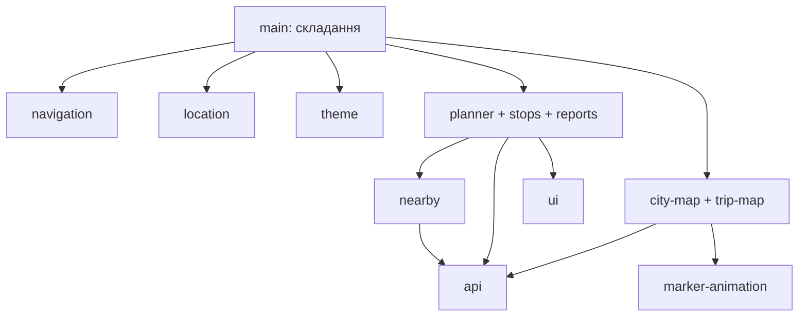

# План поступової реорганізації фронтенду

**Статус: завершено й прийнято власником проєкту 07.11.2026.**

Власник підтвердив завершення рефакторингу фронтенду. Відкритих етапів
цього плану немає. Розділи 1–11 нижче збережено як історичний план від
31.10.2026, а не актуальну чергу робіт чи вимоги до повторного приймання.
Формулювання про майбутню реалізацію, старий `app.js`, тимчасові мости
та відсутність тестів описують стан на час підготовки плану.

**Пізніше оновлення, 08.11.2026:** адресний пошук планувальника переключено
з MapTiler Geocoding на локальний Kotlin `/addresses/search` із PRG SQLite.
Наведені нижче історичні вимоги про незмінний bbox і зовнішній геокодинг
описують baseline рефакторингу, а не поточну реалізацію.
Актуальні потоки й перевірки — у [architecture.md](architecture.md) та
[backend/PRG.md](../backend/PRG.md). PRG-поведінку власник окремо перевірив у браузері 08.11.2026:
наразі без зауважень, суб'єктивно значно швидше. Це не навантажувальний бенчмарк;
оцінка достатності 4 паралельних SQLite-пошуків лишається в TODO.

### Підсумок реалізації та приймання

- Фронтенд використовує нативні ES-модулі з єдиною точкою входу
  `frontend/js/main.js`, окремими модулями екранів і розділеними CSS.
- Планувальник додатково розділено на `planner.js` (координація),
  `planner-inputs.js` (поля, історія, GPS, swap і підказки),
  `planner-cards.js` (картки та розкриття) і `planner-live.js` (LIVE-сеанс).
  Коміт цього етапу: `bcf22fe` — `Refactor planner into input, card and live modules`.
- Пройшли 22 frontend-тести; тести планувальника й навігації завантажують
  справжні ES-модулі. Запуск:
  `node --experimental-vm-modules --test frontend/tests/*.test.mjs`.
- Власник перевірив застосунок у браузері та повідомив, що регресій не помітив.
  Це не твердження про окреме проходження кожного історичного сценарію,
  але приймання рефакторингу завершене рішенням власника.

### Правило подальшої роботи

Не пропонувати повертатися до цього плану або проводити додатковий
рефакторинг лише через розмір файлів, історичні чеклісти чи відсутність
позначки про перевірку окремого сценарію. Ці переліки не є залишком робіт
і не блокують завершення. Повертатися до відповідного коду слід лише
для конкретного нового завдання, виявленого дефекту або за прямим
проханням власника; зміни погоджуються окремо.

Відкриті продуктові завдання ведуться в [TODO.md](../TODO.md) і не є
незавершеними етапами цього рефакторингу.

---

**Історичний план від 31.10.2026 (розділи 1–11).**
Початковими джерелами були [архітектура](architecture.md),
[README](../README.md), тодішній `frontend/app.js` і
[index.html](../frontend/index.html). Наведені нижче структури й API
слід читати в контексті того плану, а поточну реалізацію перевіряти в коді.

## 1. Мета та межі

Рекомендація — нативні ES-модулі, невеликі функціональні контролери
та один файл складання застосунку. Кожен контролер володіє своїм станом
і ресурсами; зв'язки між екранами передаються явними функціями.
Перевага тут — можливість змінити екран без знання змінних іншого екрана,
а не просто зменшення довжини файлів.

Bundler, фреймворк, TypeScript-міграція, класи компонентів, універсальний
event bus, DI-контейнер та глобальне сховище стану не потрібні.
Запуск залишається `cd frontend && python3 -m http.server 8000`.
JavaScript завантажується браузером без npm-команд.

Зберігаємо польські тексти, DOM, класи, дизайн, історію браузера, URL і тіла
API-запитів, частоту polling та обчислення часу. Бекенд, GTFS-імпорт,
алгоритми маршрутів і API-контракти не входять до роботи.
Наявні обмеження не перетворюємо автоматично на нову функціональність.

Пропонується 15 контрольних етапів. Кожен закінчується перевіркою та
можливістю зупинитися на робочому стані. Етап 1 — фіксація поведінки;
перша зміна робочого коду — точне винесення CSS на етапі 2.

## 2. Що повторно підтверджено, а що потребує відтворення

| Спостереження в актуальному коді | Значення для міграції |
|---|---|
| Внизу HTML послідовно завантажуються MapLibre 4.7.1, config.js, класичний app.js | Не можна просто змінити останній script на module й очікувати тотожного запуску |
| Є три `DOMContentLoaded`-обробники, а також негайні DOM-прив'язки й виклики `setupRouteAutocomplete` | Пізнє завантаження старого скрипта потребує явного запуску; сама підписка на вже минулу подію не спрацює |
| HTML і JS-шаблони містять inline `onclick` | Функції після перенесення в модуль не будуть автоматично доступні цим атрибутам |
| `trackedTripId` не оголошений; запис є в `stopVehicleTracking`, читання — в `refreshTrackedVehicle` | Строгий режим вимагає явного власника; це необхідна адаптація, не нова можливість |
| `trackUserLocation` оголошений двічі, робоче визначення пізніше | Обидва визначення не переносити в один модуль: залишити одну робочу функцію, перевіривши її виклики |
| Координати читаються через `userLocationMarker.getLngLat()` | GPS не можна винести лише копіюванням watchPosition: треба замінити читачів координат |
| `animStep` обслуговує обидві карти й викликає кластеризацію головної | Анімація має віддавати callback, а не імпортувати контролер головної карти |
| `showVehicleOnMap` має AbortController, перевірки сесії та inFlight | Це вже наявний захист; перенесення повинно його зберегти |
| `applyTheme` видаляє modalMap без повного закриття сесії | Це факт реалізації; конкретний дефект інтерфейсу треба відтворити, а зміну поведінки погодити окремо |
| Nearby-кеш спільний, TTL 120000 мс, без ключа координат | Спочатку переноситься та сама семантика, а не додається географічна інвалідація |
| Таймери Trasa читають data-*; табло відновлює панель через nextElementSibling | DOM наразі є частиною стану; не перебудовувати його разом із модулями |
| refreshMapMarkers і drawVehicleMarker починаються з return | Це вимкнені гілки, а не доказ поломки діючої LIVE-карти |
| sendQuickReport не робить POST; FAB відкриває openModal | Не підключати швидку форму до сервера під виглядом рефакторингу |

Гонки відповідей, інший часовий пояс браузера, апостроф у назві з історії,
накладання шарів та поведінка теми під час відкритої мінікарти — окремі
сценарії перевірки. Статичний аналіз вказує ризики, але не доводить,
що кожен із них уже спричиняє видиму помилку. Базову поведінку фіксуємо
до змін, потім відрізняємо наявне обмеження від нової регресії.

## 3. Рекомендована структура

```text
frontend/
  index.html                 # наявна розмітка, без завантаження HTML-фрагментів
  config.js                  # локальний класичний скрипт, як зараз
  config.example.js
  manifest.json
  style-light.json
  style-dark.json
  *.svg, favicon.png         # залишаються на поточних місцях
  css/
    base.css                 # палітра, тема, reset, safe-area, загальна розмітка
    shared.css               # спільні іконки, підказки, позначки ліній, toast
    map.css                  # DOM-маркери, контроли, модальна карта
    planner.css              # Trasa та її розгорнуті картки
    stops.css                # Przystanek, табло, свайп-індикатори
    reports.css              # стрічка, основна/швидка форми
    compatibility.css        # лише потрібні поки що каскадні перевизначення
  js/
    main.js                  # єдина кінцева точка входу type="module"
    config.js                # читання зовнішньої конфігурації
    api.js                   # адресація наявних HTTP-запитів
    ui.js                    # toast, escapeHtml, fingerprint
    theme.js                 # налаштування теми й сповіщення про її зміну
    location.js              # GPS-дані, без об'єктів MapLibre
    nearby.js                # спільний кеш даних nearby, без DOM
    marker-animation.js      # один цикл руху маркерів для обох карт
    city-map.js              # головна карта, GPS-візуалізація, LIVE та кластери
    trip-map.js              # сесія мінікарти та її геометрія
    navigation.js            # вкладки, History API, overlay і drawer
    planner.js               # весь сценарій Trasa
    stops.js                 # весь сценарій Przystanek
    reports.js               # стрічка, голоси, основна й швидка форми
```

`app.js` залишається на перехідний період. Тимчасові `css/legacy.css`
та `css/stop-overrides.css` потрібні для першого точного винесення CSS;
розподіл за відповідальністю виконується окремим завершальним етапом.
`compatibility.css` не має бути місцем для нових стилів: кожен залишений
там блок повинен пояснювати, який порядок перекриття він зберігає.

HTML не розбиваємо на динамічно завантажувані partials. Для поточного
статичного сервера це додасть асинхронну залежність без користі.
Генератори карток залишаються поруч зі своїм екраном. Окремі файли шаблонів
або render-модулі потрібні лише якщо згодом з'явиться самостійний повторно
використовуваний компонент; у цьому плані їх немає.

### 3.1. Інтерфейси майбутніх модулів

Експорти нижче — перелік дозволених зовнішніх операцій, а не вимога
експортувати всі перенесені функції. Внутрішні змінні не експортуються.
`init*` означає явну одноразову прив'язку до DOM/залежностей;
`dispose*` — очищення створених цим власником ресурсів.

| Модуль | Відповідальність, функції й стан | Запропоновані `export` | Залежності |
|---|---|---|---|
| `main.js` | Складає контролери, передає callback-и, запускає застосунок один раз | Немає, це точка входу | Усі потрібні модулі; лише тут читається `window.maplibregl` |
| `config.js` | Поточна логіка `API_BASE_URL`, читання `window.MAPTILER_KEY`, числові константи, які справді спільні | `readConfig()` → `{apiBaseUrl, mapTilerKey}`; `REPORT_TTL_MS` | location сторінки та window-конфіг; без DOM-прив'язок |
| `api.js` | Будує наявні URL для API, MapTiler і OSRM; не малює помилки | `initApi(config)`, `requestApi(path, options)`, `requestGeocoding(query)`, `requestRoadGeometry(coords)` | config передається аргументом, browser fetch |
| `ui.js` | `showToast`, `escapeHtml`, `getFingerprint`; тільки toastTimeout, формат fingerprint незмінний | `showToast`, `escapeHtml`, `getFingerprint`, `disposeUi` | DOM, localStorage; не імпортує екрани |
| `theme.js` | `THEME_CYCLE`, іконки, `getThemePref`, `getEffectiveTheme`, `mapStyleFor`; OS change listener | `initTheme({onChange})`, `getThemePref`, `getEffectiveTheme`, `mapStyleFor`, `cycleTheme`, `getThemeButton`, `disposeTheme` | DOM, localStorage, matchMedia; не імпортує карти |
| `location.js` | Робочий watch із `trackUserLocation`; останні lat/lon/accuracy, watchId, підписники | `startLocation`, `getPosition`, `requestPosition`, `subscribePosition`, `disposeLocation` | navigator.geolocation; повідомлення про помилки через callback |
| `nearby.js` | globalCachedNearbyStops/Time; один кеш для двох екранів | `getNearbyStops(lat, lon)`, `clearNearbyCache` | `api.js`; без location і без DOM |
| `marker-animation.js` | `animateMarkerTo`, `animStep`, MOVE_*, animatingMarkers, lastClusterTs | `initAnimations({maplibregl})`, `animateMarkerTo`, `cancelMarkerAnimation`, `setAnimationTickHandler`, `disposeAnimations` | performance/requestAnimationFrame; MapLibre передається при ініціалізації для LngLat |
| `city-map.js` | `initMap`, `apply3D`, LIVE-маркери, кластеризація, `updateUserLocationAccuracyCircle`; map, mapIs3D, appliedMapTheme, watch-візуалізація та liveMapInterval | `initCityMap(deps)`, `startCityLive`, `updateUserPosition`, `applyMapTheme`, `refreshClusters`, `disposeCityMap` | `api.js`, `marker-animation.js`; MapLibre, тема та callbacks передаються через deps |
| `trip-map.js` | `showVehicleOnMap`, `closeVehicleMapModal`, `drawRouteShape` та геометричні помічники; весь modal*-стан | `initTripMap(deps)`, `showVehicleOnMap`, `closeVehicleMapModal`, `handleThemeChange`, `disposeTripMap` | `api.js`, `marker-animation.js`, `ui.js`; getters координат/теми й History-операції через deps |
| `navigation.js` | `switchScreen`, open/closeDrawer, overlay, popstate; видимість оболонки, поточний screen | `initNavigation(ports)`, `switchScreen`, `openDrawer`, `closeDrawer`, `showOverlay`, `hideOverlay`, `pushOverlay`, `back`, `disposeNavigation` | DOM/History; виклики екранів через ports, без імпорту екранів |
| `planner.js` | routeFromStop/ToStop, історія, autocomplete, buildJourneyCard, LIVE-час, fetchLegStops, toggleTrasaExpand, свайпи, таймер | `initPlanner(deps)`, `enterPlanner`, `closePlannerAccordion`, `disposePlanner` | `api.js`, `ui.js`, `nearby.js`; GPS, відкриття карти, History через deps |
| `stops.js` | Пошук, loadDepartures, renderDepExpand/toggleDepExpand, історія, offsets, currentDeparturesData, свайпи, таймер | `initStops(deps)`, `enterStops({isBackAction})`, `closeDepartureAccordion`, `setStopsVisible`, `disposeStops` | `api.js`, `ui.js`, `nearby.js`; GPS, карта, History через deps |
| `reports.js` | reportsById, reportCardHtml, vote, openUpdateModal, форми, autocomplete, allRoutesCache та updateContext | `initReports(deps)`, `renderReportsList`, `openModal`, `closeModal`, `closeQuickModal`, `disposeReports` | `api.js`, `ui.js`; overlay/drawer через deps; quick-функції лишаються приватними |

`getThemeButton` повертає текст/іконку поточного контролу, не MapLibre-кнопку.
`initCityMap` повертає Promise готовності або приймає `onLoad`: обрати один
спосіб при реалізації, не використовувати обидва. Карта не публікується
як загальна змінна; для тимчасового старого коду дозволений вузький getter,
який видаляється після перенесення останнього споживача.

`requestApi` повертає `Response`, а не універсально розібраний JSON.
Це дозволяє зберегти різну обробку 404, 429, тексту помилки й порожніх списків
у наявних викликах. Аналогічно не додавати автоматичні retries, кеш запитів
або нове перетворення HTTP-помилок у спільному шарі.
LocalStorage історії поїздок/зупинок залишається в їхніх модулях,
без нового універсального storage-сервісу. Функції форматування часу
спочатку лишаються у відповідного власника: схожий вигляд не гарантує
однакової семантики службових хвилин і часу браузера.

### 3.2. Власники стану та зв'язки без циклічних імпортів

`main.js` імпортує модулі та передає звичайні функції, наприклад:

```javascript
// Схема зв'язків, не готовий код запуску.
initStops({
  getPosition,
  requestPosition,
  openTripMap: showVehicleOnMap,
  pushOverlay,
  back,
});
```

Це локальна передача конкретних операцій. Не потрібен об'єкт усього стану.
Модулі planner/stops/reports не імпортують navigation або один одного;
navigation не імпортує їх у відповідь. Він отримує порти `enterPlanner`,
`enterStops`, `renderReportsList`, `closePlannerAccordion`,
`closeDepartureAccordion`, `closeVehicleMapModal`, `closeReportForms`.
Координатор з'єднує їх до першого переходу.



Схема показує статичні залежності; callbacks із `main` забезпечують
взаємодію екранів і навігації, не додаючи імпортів у зворотний бік.

Конкретні правила володіння:

- **Карти:** `city-map` володіє головною картою, GPS-маркером і точністю;
  `trip-map` — іншою картою, копією GPS-маркера, камерою та сесією.
  Мінікарта отримує числові координати через getter, не посилання на чужий маркер.
- **GPS:** `location` володіє даними та watch. Перший marker/flyTo на головній
  карті лишається в `city-map`. Готовність координат — `null` до першої
  позиції; не підставляти центр Любліна замість відсутнього GPS.
  `requestPosition` зберігає чинні одноразові GPS-запити для nearby.
  Не додавати автоматичний запуск watch до `map.load`.
- **Анімація:** один спільний RAF-цикл, індивідуальне скасування маркера.
  `setAnimationTickHandler` з'єднується з `city-map.refreshClusters` через
  main. Поріг приблизно 600 мс і завершальне оновлення кластерів зберігаються.
  Закриття мінікарти не зупиняє анімацію головної карти.
- **Nearby:** один приватний кеш, незмінні 2 хвилини. Caller вирішує,
  коли запитувати GPS і як показати помилку/групи. Різну чинну обробку
  неуспішного HTTP-статусу в двох екранах треба зафіксувати до уніфікації:
  злиття цієї поведінки не приховувати в перенесенні кешу.
- **Навігація:** одна реєстрація popstate; один власник видимості вкладок,
  drawer та спільного overlay. Reports керує полями й станом форм,
  але просить оболонку показати/сховати затемнення. Не вводити новий стек
  модальних вікон: зберегти поточний порядок закриття.
- **Екрани:** planner і stops володіють DOM своїх карток, історією й таймерами.
  DOM `data-*` залишається їхнім внутрішнім представленням стану.
  Reports володіє словником звітів, голосами й обома формами; поділяти
  ці частини на додаткові модулі зараз немає потреби.

### 3.3. Життєвий цикл ресурсів

Кожен `init` захищений від повторної реєстрації. Обробники DOM/MapLibre,
timeouts, intervals, controllers та unsubscribe зберігаються у їхнього
власника. `dispose` прибирає тільки його ресурси. Це не загальний менеджер
ресурсів і не автоматичне переписування політики polling.

| Власник | Що переноситься без зміни моменту запуску | Як очищати |
|---|---|---|
| city-map | LIVE 5000 мс після load; кластери, rotate/zoom/pitch/style.load | clearInterval, off, скасування власних анімацій, remove маркерів і карти |
| location | watchPosition після map.load; поточні GPS options | clearWatch та відписки |
| trip-map | timeout 200 мс, polling 5000 мс, AbortController, session/inFlight | Той самий closeVehicleMapModal: abort, clearTimeout/Interval, remove |
| planner | Таймер 15000 мс після успішного пошуку | clearInterval у dispose, не при звичайному переході вкладки |
| stops | Інтервал 15000 мс; запит лише при видимій вкладці | Зберегти перевірку видимості; clearInterval у dispose |
| theme/ui/reports | OS change, toast timeout, field timeouts/listeners | Видалити лише їхні підписки й timeout-и |

У знятих із виконання DOM-власників результат pending-запиту не повинен
повторно малювати інтерфейс: перевірка `disposed` є адаптацією нового lifecycle.
Захист від гонок різних пошуків у ще активному екрані, масове AbortController
для всіх fetch і зупинка polling при document.hidden — окремі покращення.
Не включати їх непомітно в міграцію.

## 4. Як переходити на ES-модулі поступово

### 4.1. Тимчасове співіснування

Використати один перехідний простір `window.transitMigration` для вузьких
операцій, не для даних. Це адаптер із датою видалення — етап 14.
Старі змінні не копіюються в нього. Наприклад, тимчасовий
`getPosition()` повертає координати, а не `userLocationMarker`.

На етапі 4 HTML замість прямого завантаження app.js підключає
`<script type="module" src="js/main.js"></script>`. MapLibre й config.js
залишаються перед ним класичними скриптами без async.
Перехідний main:

1. Імпортує нові базові модулі, готує їх та вузький адаптер.
2. Чекає готовності DOM з перевіркою `document.readyState`.
3. Один раз завантажує старий app.js як **класичний** script, чекає його load.
4. Завершує wiring callbacks і явно викликає адаптер запуску старої частини.
5. Нові модулі не стартують другу карту або другі таймери паралельно зі старими.

URL старого скрипта формується як `new URL('../app.js', import.meta.url)`
із main.js, щоб шлях не залежав від припущення про поточний каталог.
Не залишати одночасно статичний script app.js і його динамічне підключення.
Помилка завантаження завершує запуск явно; не робити автоматичний fallback,
який може повторно виконати половину вже запущеного застосунку.

Цей механізм працює лише після етапу 3: старі DOMContentLoaded-блоки мають
бути доступними явному startup-виклику. Інакше при повільному імпорті
браузер уже завершить цю подію. Негайні прив'язки старого app.js можуть
тимчасово залишатися на верхньому рівні: DOM до його підключення вже готовий.

Перенесення фічі означає одночасно забрати її обробники/таймери зі старого
виконуваного шляху та підключити новий модуль. Тимчасові wrappers делегують
виклики модулю, а не повторюють його реалізацію. Кожен адаптер має явних
споживачів і видаляється разом з останнім із них.

### 4.2. Inline-обробники й глобальні функції

Для ще не перенесених ділянок старі глобальні функції залишаються доступними.
Для перенесеного компонента прибрати його inline-виклики та поставити
локальні addEventListener або делегування на його постійному контейнері.
Не робити `Object.assign(window, allExports)`.

| Поточні inline-виклики | Коли й чим замінювати |
|---|---|
| HTML `switchFormTab`, quick options/close/send/manual | Етап reports: обробники в initReports, preventDefault для manual-link |
| HTML `switchScreen` у нижньому меню | Етап navigation: один набір обробників із збереженням btn/currentTarget |
| Шаблони `showVehicleOnMap` у табло й Trasa | Під час перенесення відповідного екрана: callback, пов'язаний із dep/leg та routeContext |
| Шаблони `vote`, `openUpdateModal` | Локальне делегування в drawer-list із reportId і типом дії |
| `applyRecentRoute(JSON.stringify(route))` | В init/render planner: listener із замиканням над route або індексом у приватному списку |

Контекст мінікарти з координатами не потрібно серіалізувати в onclick:
його передає замикання. Зберегти stopPropagation, preventDefault,
поведінку `.closest(...)`, порядок кліків і pointerdown, що утримує
фокус поля. Це адаптація способу виклику, а не зміна обраної дії.

### 4.3. Строгий режим, імпорти та готовність

- Модулі виконуються у строгому режимі; `trackedTripId = null` без
  оголошення переносити не можна. Старий tracking-стан спочатку оголосити
  локально, поки не вирішено питання його видалення; не запускати старе
  відстеження замість сучасної мінікарти.
- У модулі не можуть співіснувати два однойменні верхньорівневі визначення
  trackUserLocation як у класичному app.js. Порожня заглушка не переноситься;
  для старих викликів лишається wrapper робочої функції.
- Imported binding не можна переприсвоювати. Власник кешу/карти змінює
  стан через метод, споживач отримує знімок або операцію, не writable export.
- Усі локальні імпорти мають `./` або `../` і розширення `.js`.
  Не використовувати bare import `maplibre-gl`, import-map або CDN ESM-конвертер:
  поточна бібліотека лишається window.maplibregl, її значення передає main.
- Ключ читати через `window.MAPTILER_KEY`, а не покладатися на вільне ім'я
  MAPTILER_KEY у кожному файлі. Локальний frontend/config.js залишається сумісним.
- Не виконувати querySelector, створення карти, підписки й polling при
  статичному імпорті фічі. Виконувати їх у явному init після готовності DOM.
- DOM ready не дорівнює MapLibre load. Location watch і LIVE-карта стартують
  після load головної карти; style.load окремо відновлює 3D й GPS-коло.
  Запуск головної карти — один раз, а не після кожного style.load.
- Необхідний HTTP-запуск, а не file://. Перевіряти JS MIME, 404 та кеш браузера
  для кожного нового файлу. API-CORS не вирішує помилки імпорту статики.

## 5. HTML та CSS: збереження каскаду

Перший CSS-етап — буквальний перенос вмісту двох style-блоків у два файли
зі збереженням їхнього порядку: legacy.css, потім stop-overrides.css.
Підключення можна спочатку поставити на місця старих блоків; перенесення
обох link у head перевіряти окремо. Вбудований скрипт початкової теми
лишається в head, без очікування модулів, щоб не додати спалах світлої теми.

При переміщенні CSS у css/ відносні `url('fast.svg')`, `slow.svg`, `ok.svg`,
`bus.svg` мають стати `url('../fast.svg')` тощо. Data URI не змінюються.
URL у незмінених inline-стилях HTML/JS як і раніше відносні до сторінки.
Адреси style-light/dark.json не стають автоматично відносними до js/:
для fetch/MapLibre URL треба явно зберегти поточне розташування ресурсів.

На етапі 15 стилі групуються за відповідальністю. Базовий порядок link:
MapLibre CSS → base → shared → map → planner → stops → reports → compatibility.
Це запропонований порядок, а не доказ еквівалентного каскаду:
перед кожним переносом порівнюються всі правила того самого селектора
та перекриття спільних класів. Якщо порядок важливий, завершальне
перевизначення лишається в compatibility з поясненням.

Не змінювати специфічність, !important, значення кольорів і розмірів,
префікси -webkit-mask, keyframes, vh/dvh-fallback, --safe-top/bottom,
overflow, position, transform або z-index під час переміщення.
Поточні темні та світлі перекриття кнопок звітів зберігаються, а не
«виправляються» групуванням. Модальна карта, overlay, drawer, меню й картка
fullscreen-expanded мають різних батьків: перевіряти stacking contexts,
а не лише числові z-index.

Статичні inline-стилі можна переносити по одному компоненту після
порівняння computed styles. Динамічні величини — позиція dropdown від
getBoundingClientRect, transform стрілки, висота індикатора свайпу —
залишаються керованими JS. Не вимагати відсутності всіх `.style` як
формального критерію. Створені JS класи маркерів, карток і підказок
мають бути покриті відповідним CSS, навіть якщо їх немає у статичному HTML.

## 6. Послідовність міграції

У кожному етапі: базовий набір перевірок Б із розділу 8 + наведені
спеціальні перевірки. Перехід далі — після ручного прийняття результату.
Файли нижче — майбутні зміни після окремого дозволу, не зміни цього документа.

### Етап 1. Зафіксувати поточну поведінку

- **Мета й файли:** без правок робочих файлів; записати baseline перевірок
  у погодженому звіті етапу, зокрема початкові Git-зміни й версії браузерів.
- **Дії/залежності:** пройти Б, К, П, З, Р з розділу 8; зберегти пари точок,
  stopId, приклад tripId, час, Network і знімки екрана. Позначити недоступні
  через GPS/LIVE сценарії, не називати їх успішними.
- **Ризик:** мінливі зовнішні дані. Порівнювати структуру й дії, не точні
  хвилини прибуття через годину після baseline.
- **Завершення:** погоджений перелік працюючих сценаріїв і відомих обмежень.

### Етап 2. Точно винести два CSS-блоки

- **Мета/файли:** index.html, нові css/legacy.css та css/stop-overrides.css.
- **Перенос:** весь текст style-блоків; без очищення дублікатів чи класів.
  Адаптація лише шляхів url і link; тема в head лишається.
- **Ризик:** URL SVG, каскад, затримка завантаження CSS.
- **Перевірка:** Б + К/П/З/Р в обох темах, CSS/SVG без 404,
  порівняння computed styles та мобільної висоти dropdown.
- **Завершення:** той самий вигляд і поведінка, обидва style-блоки замінені,
  жодного JS-перенесення в цьому етапі.

### Етап 3. Явний запуск старої частини

- **Мета/файли:** тільки app.js; підготувати пізнє класичне завантаження.
- **Перенос:** тіла трьох DOMContentLoaded-блоків у явні startup-функції;
  `startLegacyApp` виконує їх у початковому порядку один раз. При звичайному
  script виклик через readyState/DOMContentLoaded, при migration — тільки
  за командою main. Негайні bindings поки залишаються на місці.
- **Адаптація:** явний прапорець режиму запуску, не опитування «чи модулі вже готові».
  Реєстрація map.load лишається поруч зі створенням карти.
- **Ризик:** подвійний init та зміна порядку історії/рендеру.
- **Перевірка:** Б + К; одна карта, один LIVE-інтервал, одна replaceState;
  тест звичайного запуску й виклику startup після DOM ready.
- **Завершення:** старий frontend працює без ES-entry; явний startup не дублює ресурси.

### Етап 4. ES-entry і базові залежності

- **Мета/файли:** index.html, app.js; нові js/main.js, config.js, api.js, ui.js.
- **Перенос:** конфіг, showToast/escapeHtml/getFingerprint; запити екранів
  поки можуть лишатися на місці. Main завантажує app.js за схемою розділу 4.1.
- **Адаптація:** window.transitMigration лише з потрібними операціями;
  класичні wrappers зберігають доступ старим викликам; конфіг та MapLibre
  готові до startup. Не міняти формат fingerprint і HTTP-помилок.
- **Ризик:** app.js завантажився після DOMContentLoaded, різні бази URL,
  повторне підключення скрипта.
- **Перевірка:** Б + Р, повільна мережа/вимкнений кеш; правильні API URL,
  лише одне виконання app.js, відповідь 429 як раніше.
- **Завершення:** ES-entry працює зі старими екранами, запуск через Python збережений.

### Етап 5. Єдиний власник nearby-кешу

- **Мета/файли:** новий js/nearby.js, app.js, main.js, api.js.
- **Перенос:** globalCachedNearbyStops/Time та дві перевірки TTL.
  Дані повертаються caller-у; групування та DOM лишаються у старих екранах.
- **Адаптація:** обидва споживачі одночасно використовують той самий кеш;
  при потребі зберегти окремі гілки обробки HTTP-статусу без зміни успішних даних.
- **Ризик:** ненавмисно два кеші, нова прив'язка до координат або зміна помилок.
- **Перевірка:** З/П, спочатку один екран, потім другий до/після 2 хв;
  Network підтверджує стару семантику повторного запиту.
- **Завершення:** дані та TTL мають одного власника, старі cache-змінні більше не записуються.

### Етап 6. Спільна анімація без залежності від карти міста

- **Мета/файли:** js/marker-animation.js, app.js, main.js.
- **Перенос:** animateMarkerTo, animStep, набір маркерів, пороги й RAF-стан.
- **Адаптація:** кластеризація підключається callback-ом; старі головна
  й модальна карти викликають один animator через wrappers.
- **Ризик:** заміна одного циклу двома або видалення чужих маркерів при close.
- **Перевірка:** К, одночасний рух на обох картах, повторні open/close,
  стрибок позиції та background/foreground, кластери після завершення руху.
- **Завершення:** один RAF-власник, скасування маркера мінікарти не зачіпає місто.

### Етап 7. GPS як дані, окремі від DOM-маркера

- **Мета/файли:** js/location.js, app.js, main.js.
- **Перенос:** робочий watch та його параметри. Рендер маркера й точності
  поки лишається в старій головній карті як callback нових координат.
- **Адаптація:** усі читачі `userLocationMarker.getLngLat()` у nearby,
  dynamic GPS і мінікарті переходять на getPosition; геолокаційні fallback-и
  на requestPosition. Порожній trackUserLocation не переноситься.
- **Ризик:** зміна моменту запиту дозволу або null-готовності координат.
- **Перевірка:** К/П/З з дозволом, відмовою та повільним першим fix;
  перше flyTo, точність, Moja lokalizacja, nearby без активного watch.
- **Завершення:** числові координати не залежать від доступності маркера;
  один власний watch, GeolocateControl не підмінений ним.

### Етап 8. Тема без прямого доступу до карт

- **Мета/файли:** js/theme.js, app.js, main.js; ранній script у HTML лишається.
- **Перенос:** theme preferences, іконки, OS-listener, зміна data-theme/meta.
  syncMapStyle й видалення modalMap викликаються через сумісні callbacks.
- **Адаптація:** тема не імпортує карти. Тимчасовий callback повторює стару
  дію з modalMap; повне закриття сесії не додається без окремого рішення.
- **Ризик:** спалах теми, повторне setStyle, приховане виправлення lifecycle.
- **Перевірка:** К, reload у кожному режимі, OS change в Auto з відкритою
  мінікартою; відмінність від baseline зупиняє етап.
- **Завершення:** один OS-listener і збережена реакція обох карт.

### Етап 9. Головна карта зі своїм LIVE-станом

- **Мета/файли:** js/city-map.js, app.js, main.js.
- **Перенос:** initMap, controls/3D, style.load, GPS-візуалізація,
  updateLiveCityMap, activeVehicleMarkers, clustering та liveMapInterval.
- **Адаптація:** MapLibre/theme/GPS/animator передаються явно;
  тема не читає новий приватний map, а викликає applyMapTheme.
  Legacy-виклики карти замінюються вузькими wrappers, не копією map.
- **Ризик:** кластери/3D губляться після стилю, другий polling, переставлений map.load.
- **Перевірка:** повний К; Network одна серія /live-vehicles, GPS та style.load
  не запускають новий interval; усі вкладки поверх карти як раніше.
- **Завершення:** головна карта та її маркери мають одного власника.

### Етап 10. Мінікарта як окрема сесія

- **Мета/файли:** js/trip-map.js, app.js, main.js, api.js.
- **Перенос:** modal*-стан, show/close, fetchVehiclePosition, drawRouteShape
  і математичні помічники. Глобальний showVehicleOnMap тимчасово делегує модулю.
- **Адаптація:** отримання координат/теми через getters, History через
  callback-и старої навігації, збереження session/inFlight/AbortController.
  handleThemeChange повторює погоджену на етапі 8 дію.
- **Ризик:** стара відповідь відкриває закриту карту, втрата контексту Trasa,
  зміна OSRM fallback або автостеження.
- **Перевірка:** К/П/З: відкрити, одразу закрити, відкрити інший trip,
  drag, Назад, відсутній GPS рейсу, помилка OSRM, перемикання теми.
- **Завершення:** close прибирає свої ресурси; головна карта працює далі.

### Етап 11. Самостійний екран Przystanek

- **Мета/файли:** js/stops.js, app.js, main.js; розмітка без перебудови.
- **Перенос:** пошук/історія, nearby-render, loadDepartures, expand,
  currentStopIdForDepartures/currentDeparturesData, offsets, свайпи й interval.
- **Адаптація:** getters GPS, nearby, callback мінікарти й History;
  старий switchScreen викликає enterStops/setStopsVisible замість читання стану.
  Inline showVehicleOnMap у його шаблонах прибирається.
- **Ризик:** втрата відкритої панелі, скролу, дубль timer або зміна ключа запису.
- **Перевірка:** весь З + відкриття карти й Назад; дочекатися 2 оновлень,
  піти на іншу вкладку й перевірити відсутність запитів табло там.
- **Завершення:** у старому файлі немає записів у стан табло; екран працює автономно.

### Етап 12. Самостійний планувальник Trasa

- **Мета/файли:** js/planner.js, app.js, main.js.
- **Перенос:** поля/історія, autocomplete, swap/GPS, пошук і картки,
  часові помічники, LIVE-refresh, розкриття та свайп пізніших поїздок.
- **Адаптація:** зовнішні callbacks GPS/мінікарти/History; timer замість
  window.trasaCountdownInterval приватний. Навігація викликає enterPlanner
  й closePlannerAccordion; inline історії/карти замінюються listeners.
- **Ризик:** повторне додавання затримки, втрата toStopId/context, зміна
  фокусу Swap, множника піших хвилин або параметра time.
- **Перевірка:** весь П і К із Trasa, мінімум 2 LIVE-оновлення, поля з адресою
  та групою платформ; параметри API і data-* порівнюються з baseline.
- **Завершення:** весь стан Trasa приватний, немає його глобальних inline-викликів.

### Етап 13. Самостійні звіти й форми

- **Мета/файли:** js/reports.js, app.js, main.js, index.html для його onclick.
- **Перенос:** fetch/render звітів, голоси, словник, основна/швидка форми,
  updateContext, autocomplete, validation/reset, прив'язки FAB і кнопок.
- **Адаптація:** оболонка передає drawer/overlay-операції. Запити отримують
  Response; 429 і текст серверної помилки лишаються обробленими як зараз.
  Quick-report лишається без POST. Дубль focus-listener спочатку врахувати
  як наявну поведінку, його видалення не змішувати з переносом.
- **Ризик:** зайвий POST/голос через два listeners, втрата оригіналу цитати,
  випадкове відкриття quick-замінника замість основної форми.
- **Перевірка:** Р на локальному тестовому середовищі; bodies запитів,
  ті самі значення fingerprint, повторний/протилежний голос, update і помилки.
- **Завершення:** стан звітів приватний, усі його inline-обробники прибрані.

### Етап 14. Навігація та завершення JS-переходу

- **Мета/файли:** js/navigation.js, main.js, index.html, app.js.
- **Перенос:** switchScreen, open/closeDrawer, overlay, popstate, початковий
  replaceState. Статичні onclick меню замінюються listeners.
- **Адаптація:** main з'єднує порти всіх перенесених екранів, ініціалізує їх
  до першого переходу й запускає карту. Тимчасове завантаження app.js та
  transitMigration зникають. Стара tracking-гілка не запускається.
- **Ризик:** зміна порядку history/back/overlay або залишені виклики
  неіснуючих глобальних функцій. Для старих заглушок окремо перелічити
  споживачів: підтверджене видалення — лише після погодження. Якщо його
  не погоджено, старий файл лишається в репозиторії, але не завантажується,
  а його потрібні no-op wrappers перенесені явно.
- **Перевірка:** всі набори Б/К/П/З/Р, пошук onclick/вільних старих імен,
  один popstate, Назад/Вперед і overlay за baseline; відсутній app.js у Network.
- **Завершення:** один ES-entry, немає runtime bridge, циклічних імпортів,
  mutable globals екранів, нових подвійних обробників або неперенесеної активної логіки.

### Етап 15. Групування CSS і завершальний огляд

- **Мета/файли:** css/base/shared/map/planner/stops/reports/compatibility.css,
  index.html; старі legacy/stop-overrides.css замінюються погодженими файлами.
- **Перенос:** по одному блоку відповідальності за правилами розділу 5;
  допустимі окремі перевірені підкроки, не один великий shuffle.
  Зовнішній вигляд та DOM не змінюються, CSS-дублі не чистяться автоматично.
- **Ризик:** перестановка однакових правил, stacking contexts, мобільна клавіатура,
  незастосовані стилі динамічних елементів.
- **Перевірка:** усі набори й знімки тем; computed styles спільних класів;
  немає 404 CSS/іконок, safe-area та swipe працюють у мобільному браузері.
- **Завершення:** відповідальності стилів зрозумілі, compatibility містить
  лише пояснені винятки; запуск без системи збірки повністю збережений.

## 7. Що не включати автоматично

| Категорія | Приклади | Правило |
|---|---|---|
| Необхідне для реорганізації | Imports/exports, явний startup, заміна onclick, приватний timer, getters GPS, callbacks замість доступу до чужої карти, URL CSS-ресурсів | Виконується в межах погодженого етапу, зі збереженням результату |
| Потенційні/окремі помилки | Гонки пошуку, координати в ключі nearby, локальна зона часу/DST, partial cleanup при темі, дедуплікація табло, HTML-екранування всіх назв | Спершу відтворити й погодити окрему зміну; не змінювати бізнес-результат переносом |
| Застарілий/недосяжний код | Leaflet-пошук без HTML, код після return, старе trackedTripId, порожнє trackUserLocation | Перевірити всіх читачів/виклики. Потрібні no-op залишити, видалення погоджувати; не оживляти код |
| Необов'язкові покращення | Додаткові render-модулі, загальний timer manager, shared storage, оптимізація запитів, E2E-інфраструктура, CSP, bundler | Не є критеріями завершення міграції |

Усунення повторного оголошення trackUserLocation та явне оголошення стану
для strict mode необхідні там, де інакше модуль не виконається. Це не дозвіл
видалити всі старі функції. Так само заміна onclick історії на замикання
прибирає серіалізацію в атрибут як наслідок необхідної адаптації, але
не дає дозволу паралельно переписати весь HTML-rendering.

Відсутність LIVE-позиції, 404 конкретного tripId або порожній маршрут самі
по собі не доводять регресію фронтенду. Не виправляти GTFS чи бекенд у цих етапах.

## 8. Ручні перевірки після етапів

Зараз автоматизованих тестів фронтенду немає. Нижче — запропонований
протокол майбутньої реалізації, а не перевірки, виконані під час написання плану.

### Б. Мінімум після кожного етапу

1. `git diff --check`, перегляд списку змінених файлів та diff тільки етапу.
2. Запуск через Python HTTP-сервер; hard reload з відкритими Console і Network.
   Немає нових SyntaxError/ReferenceError, 404 або MIME-помилок JS/CSS.
3. Відкрити всі 4 вкладки, основну форму, повернутися Назад.
   Активна кнопка та видимий екран збігаються з baseline.
4. Перевірити світлу/темну тему й повторне завантаження, іконки й скрол.
5. Почекати не менше 30 с: немає дубльованих серій polling. Дані GTFS
   можуть не змінитися; перевіряється кількість запущених механізмів.
6. Той самий мінімум у мобільному браузері. Позначити недоступні GPS/LIVE
   сценарії як неперевірені, не пропускати їх мовчки.

### К. Карта, GPS, тема та мінікарта

- Масштабування через поріг кластеризації, поворот, 2D/3D; кластери
  розкриваються, стрілки відповідають повороту, рух не дублюється.
- GPS дозволено/відхилено/затримано: перший маркер, коло точності,
  flyTo та повідомлення як до змін; звичайна карта доступна без дозволу.
- Auto/Day/Night, reload, системна зміна теми в Auto, style.load:
  GPS-коло й 3D відновлюються. Окремо зняти baseline з відкритою мінікартою.
- Мінікарта з Przystanek та Trasa, активний сегмент, ручний drag,
  кілька швидких open/close, Назад, інший trip до відповіді попереднього.
  Після закриття її позиційні запити припиняються, головна карта триває.
- Без позиції — той самий toast, без «порожньої нової карти».
  OSRM-помилка не повинна зламати решту застосунку.

### П. Trasa

- Зупинка → зупинка, адреса → зупинка, GPS → адреса, обмін і очищення полів.
  Після вибору в запиті правильні ids або lat/lon; bbox геокодингу незмінний.
- Історія після reload: ті самі ключі, ліміти та дія кліку. Пошук назви
  з апострофом — окремий приклад порівняння з baseline.
- Пряма поїздка й пересадка: порядок карток, час, статус і список зупинок
  до toStopId; відкрита картка та Назад. Затримка не додається двічі.
- Два LIVE-цикли, попередження пересадки за наявності таких даних,
  збереження останньої затримки при втраті LIVE.
- Свайп пізніших: додані картки, той самий time; помилка мережі та порожній список.

### З. Przystanek

- Порожнє поле: недавні та nearby, потім текстовий пошук і вибір платформи.
  Коди 01/02 і нестандартні 51/52 не втрачаються.
- Табло з LIVE і без LIVE, затримка/випередження, історичні записи;
  розгортання, два цикли оновлення, збереження скролу й панелі.
- Свайпи історії/майбутнього, повернення вкладки, відсутні відправлення,
  помилка API. Між екранами nearby-кеш лишається спільним.

### Р. Звіти, форми та overlay

- Відкриття стрічки й цитат, overlay/закриття, FAB відкриває ту саму форму.
- Linia і Przystanek: autocomplete, вибір платформи/напрямку, валідація,
  429, серверна помилка, коментар, reset. Не надсилати тестові POST у чужу БД:
  тільки погоджене локальне тестове середовище.
- Створення, повторний і протилежний голос, update власного допису:
  по одному запиту на дію, незмінний fingerprint і previousReportId.
- Швидка форма, якщо її відкривають для перевірки: не має нового POST.
  Її відсутність у звичайному шляху FAB не змінюється.
- Клавіатура не ховає поле/кнопку, дотик по пункту підказки не губиться
  через blur; drawer, форма та затемнення закриваються як у baseline.

### Мобільні умови

Перевіряти принаймні один реальний цільовий браузер; назву й версію вказати
у звіті. Якщо ціль — також iOS, Safari перевіряється окремо, емуляція
розміру у desktop Chrome не замінює цю перевірку.
Вузький екран, portrait/landscape, адресний рядок браузера, клавіатура,
safe-area, свайпи, background/foreground і повільна мережа — обов'язкові
для етапів розмітки, карт та екранів.
Для GPS на телефоні потрібне наявне погоджене HTTPS-середовище;
HTTP за LAN-адресою не вважати тестом справності геолокації.
Упровадження нового тунелю/деплою не входить у рефакторинг.

## 9. Як мати можливість відкотити етап

До реалізації кожного етапу перевіряти git status і diff, фіксувати вже
наявні зміни користувача. Поточні README та architecture можуть бути ще
не закомічені: повертатися до HEAD без їх урахування не можна.

Найзручніша контрольна точка — окремий прийнятий коміт на етап,
але створюється лише за явним проханням власника. Без дозволу на коміт
зупинятися після перевіреного diff, не накопичувати кілька незатверджених
етапів. Перед наступним етапом погодити спосіб зберегти прийнятий стан
(коміт або копія/patch із новими файлами). Звичайний git diff не включає
вміст untracked-файлів: їх треба врахувати окремо.

Для вже закоміченого етапу без переплетення сторонніх змін — окремо
погоджений git revert відповідного коміту. Для незакоміченого — цільове
відновлення саме правок етапу з контрольної точки, разом із переліком
створених файлів. Не використовувати reset --hard, git clean або загальний
restore: вони можуть знищити чужу роботу. Revert/restore/stash/гілки та
будь-які інші Git-операції зі зміною стану також потребують дозволу.

Практичний критерій відкату: нова помилка запуску, зміна API-параметрів,
поведінки Назад, подвійні ресурси або візуальна відмінність, яку не можна
пояснити baseline. Спершу зупинити етап, зафіксувати сценарій, відновити
його зміни за погодженим способом, повторити мінімум Б. Не виправляти
регресію масштабним переписуванням сусіднього модуля.

## 10. Рішення для обговорення перед реалізацією

1. **Прийняти межі й порядок:** ES-модулі без bundler та тимчасове
   співіснування із класичним app.js; саме цей адаптер робить поступовий
   перехід перевірюваним. Якщо адаптер не прийнятний, альтернативу
   планувати окремо, не замінювати його великим одночасним переносом.
2. **Вибрати baseline-середовище:** цільові desktop/mobile браузери,
   доступний спосіб перевірити GPS, локальні тестові звіти. Без LIVE-фіда
   можна завершити структурні перевірки, але не оголошувати всі сценарії прийнятими.
3. **Визначити долю старих гілок:** рекомендація — після інвентаризації
   окремо погодити видалення доведеного недосяжного Leaflet-коду;
   до цього не відновлювати його й не приховувати видалення в переносі.
4. **Окремо вирішити знайдені дефекти:** насамперед тема з відкритою
   мінікартою, часові зони, гонки й кешування. Рекомендація для міграції —
   зберегти baseline, а виправлення вести окремими погодженими змінами.
5. **Погодити контрольні точки Git:** коли власник хоче коміти й чи
   потрібен окремий коміт на етап. Сам план не є дозволом на Git-записи.

Першим рекомендується етап 1, щоб приймання спиралося на спостережувану
поведінку, а не лише на описи. Будь-яка реалізація, включно з першим
винесенням CSS, потребує окремого погодження після обговорення цього плану.


## 11. Узгоджені орієнтири для майбутнього розвитку (без розширення scope)

Цей розділ фіксує рішення власника проєкту, обговорені після підготовки
плану. Він **не додає етапів і не дозволяє змінювати функціональність**.

- **TODO залишається окремим.** Рефакторинг не реалізує нові можливості й
  не виправляє знайдені дефекти під виглядом перенесення. Майбутні
  завдання включають GPS/nearby, планувальник і піші відрізки, LIVE-табло,
  звіти та карти. Їх слід враховувати як перевірку розумності меж модулів,
  а не як вимоги до реалізації зараз.
- **Картографічні ресурси.** У перспективі бажано самостійно розміщувати
  ресурси карти лише для Любліна, наскільки це практично і дозволено
  ліцензіями: тайли, glyphs, sprites та іншу статику. Джерела ресурсів
  мають бути замінними без зміни логіки GPS, LIVE, планувальника та карт.
  Це не вимога зараз створювати tile server, копіювати карти чи міняти MapLibre.
  Геокодинг MapTiler та геометрія OSRM — окремі зовнішні залежності,
  майбутня заміна яких потребуватиме власного рішення.
- **Публічне розгортання.** Можливий майбутній недорогий VPS для фронтенду,
  Ktor API та PostgreSQL. Не зашивати у нові модулі припущень про конкретну
  локальну IP-адресу або походження API; при цьому не перебудовувати зараз
  бекенд і не впроваджувати деплой.
- **Мобільний розвиток.** Потенційні PWA, гібридна упаковка чи окремий
  нативний клієнт не є вимогами поточного етапу. Зберігати розділення
  прикладної логіки від DOM, MapLibre-маркерів і браузерного GPS там, де
  це вже передбачено планом; не додавати абстракцій під гіпотетичну платформу.
- **Браузери.** Орієнтир — сучасні настільні та мобільні браузери, без
  штучного обмеження до пристроїв власника. На baseline перевіряти реально
  доступні браузери й чесно фіксувати неперевірені платформи; не додавати
  поліфіли чи bundler наперед.
- **Git і обсяг робіт.** Лише невеликі погоджені етапи; власник вирішує,
  коли створювати коміти й робити push. Під час міграції пріоритетом є
  збереження спостережуваної поведінки.

Перед реалізацією етапу 3 окремо оцінити, чи описаний тимчасовий міст
`window.transitMigration` і динамічне завантаження `app.js` є найпростішим
надійним способом співіснування. Якщо кращий варіант знайдеться,
спочатку погодити коригування плану, а не міняти механізм самовільно.
